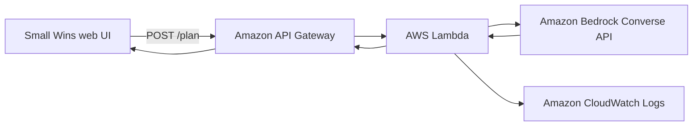

# Small Wins

> Turn an overwhelming thought dump into one kind next step.

Small Wins is a tiny AI agent for people who are stuck at the starting line. You paste what is on your mind, choose how much energy you have, and the agent returns a realistic 10-minute plan, a permission slip, and an optional follow-up prompt.

The goal is not to optimize your whole life. It is to make the next action feel possible.

## Why this fits the AWS Builder challenge

- **What and who:** A personal agent for overloaded students, builders, and knowledge workers.
- **Delightful detail:** It deliberately gives one small action rather than an intimidating list. It also explains why that action is enough for now.
- **AWS usage:** Amazon Bedrock (Nova Lite by default), AWS Lambda, and Amazon API Gateway. The static client can be hosted in Amazon S3.
- **Proof:** The UI includes a visible request state, friendly error states, and a "copy my next step" action so the useful result is easy to carry into real life.

## Architecture



## Run locally

The frontend works without a backend in demo mode, so the experience can be reviewed immediately.

```powershell
cd frontend
python -m http.server 4173
```

Open <http://localhost:4173>. To connect a deployed API, set `API_BASE_URL` near the top of `frontend/app.js`.

## Deploy the API with AWS SAM

Prerequisites:

- AWS CLI configured with credentials
- AWS SAM CLI
- Bedrock model access enabled for the selected model in your AWS Region

```powershell
sam build
sam deploy --guided
```

Set `ModelId` during the guided deployment if your region uses a different model identifier. The default is `amazon.nova-lite-v1:0`.

After deployment, copy the `ApiUrl` output into `frontend/app.js` and host the `frontend` directory in S3 (or any static host). Do not commit credentials or generated `.aws-sam` files.

## API

`POST /plan`

```json
{
  "thoughts": "I need to prepare a demo, reply to two emails, and clean my desk.",
  "energy": "low",
  "tone": "gentle"
}
```

The response is a strict JSON object:

```json
{
  "headline": "Let's make the demo feel less heavy.",
  "next_step": "Open the demo file and write the three things it must show.",
  "minutes": 10,
  "why_it_matters": "A tiny outline removes the blank-page feeling.",
  "permission_slip": "You do not need to finish the demo today.",
  "when_done": "Take a sip of water and decide whether to stop or continue."
}
```

## Safety and reliability

- The Lambda validates input size and enum values before calling the model.
- The prompt asks the model to avoid medical, legal, financial, or crisis advice.
- The response is parsed and validated; malformed model output becomes an explicit API error.
- No user text is persisted by the application.
- The UI never pretends the model succeeded when the request failed.

## Challenge submission checklist

- [ ] Complete the AWS Builder profile About section.
- [ ] Deploy the Lambda/API and host the frontend.
- [ ] Capture a screenshot or short clip showing a real request and returned plan.
- [ ] Publish the article with title `Weekend Agent Challenge: Small Wins`.
- [ ] Add the `agents` tag.
- [ ] Include the public repository or deployed URL.

## License

MIT
